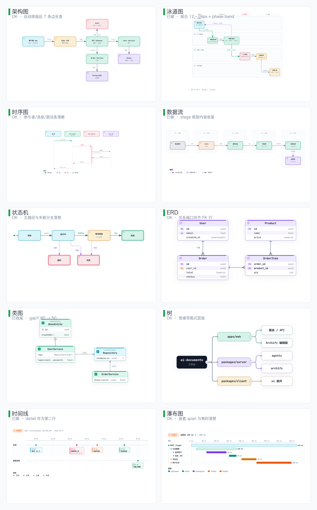
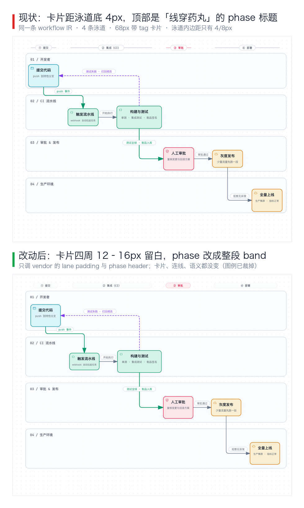
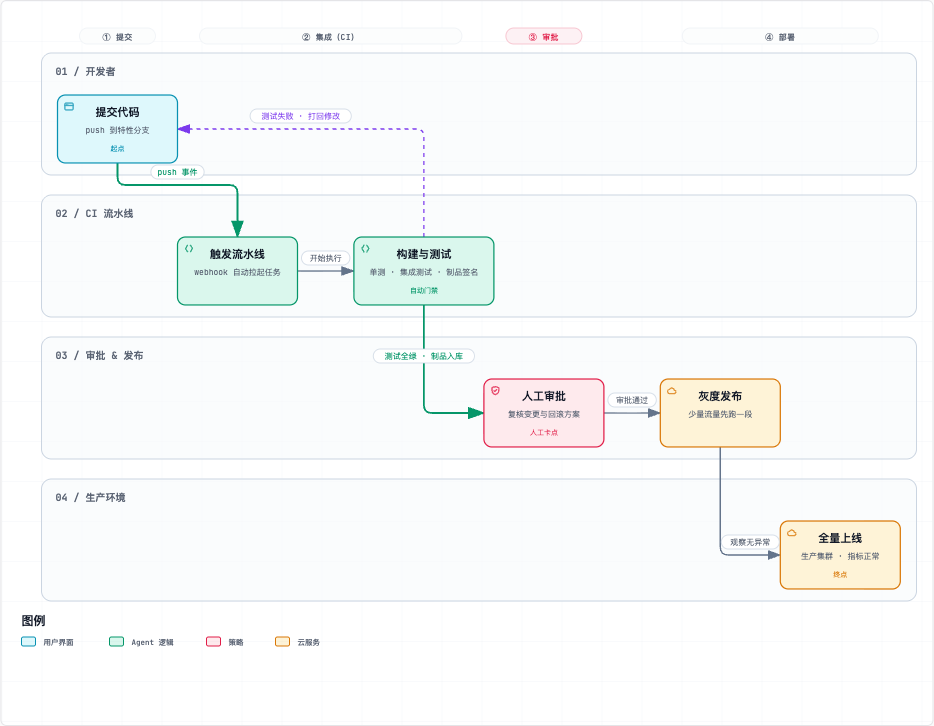
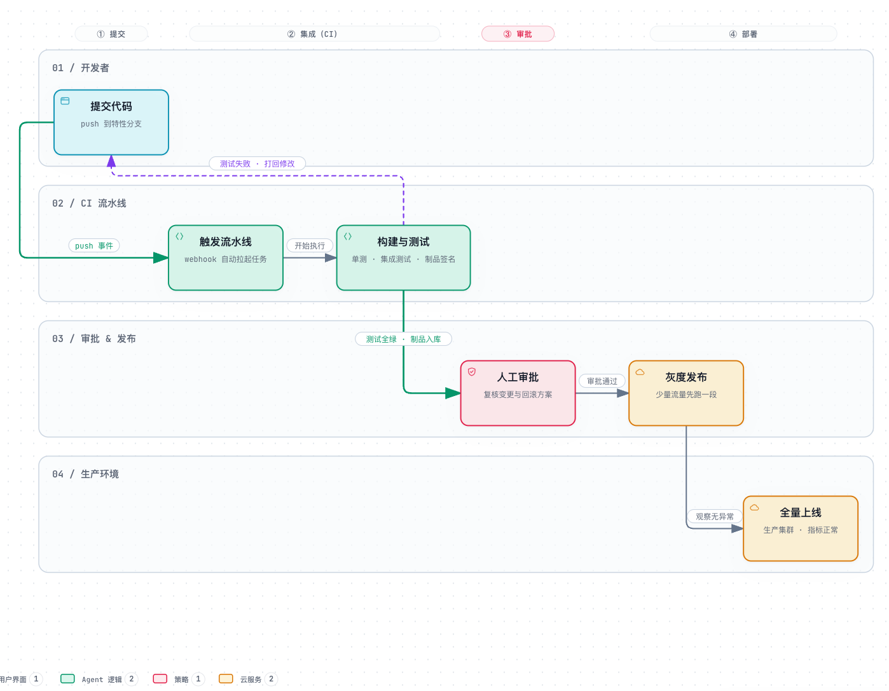
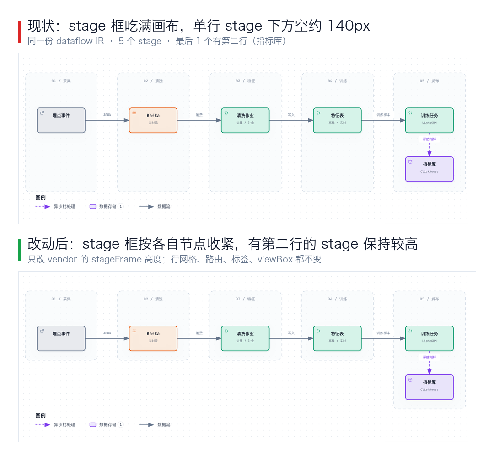
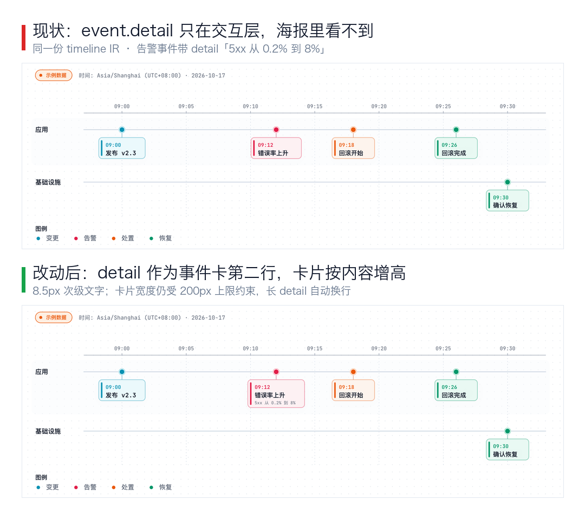

# Archify 十类图样张与逐类评估

目的：把 10 种图各生成一张可复现的样张，检查比例、留白、标签和线条，再决定哪些值得改。

所有样张都是 `showcase` + `classic` + light，同一版 vendored Archify v3.1.0；源 IR 在 [`sources/`](sources/)，PNG 是同名文件。样张只用于看布局，内容为示意。

## 总览



## 逐类结论

| 类型 | 结论 | 主要观察 | 建议 |
|---|---|---|---|
| architecture | ✅ 可用 | 自动排版后 7 条边全直、0 贴边；卡片 150×66 统一 | 保持；新图默认走 `layoutArchitecture` |
| workflow | ✅ 已修 | 卡片距泳道底 4px → 12px；顶部 phase 从「线穿药丸」改成整段 band | 见下方前后对照；回边路由仍是 M 层 |
| sequence | ✅ 可用 | 参与者 175×60、消息/激活条清楚；海报底部是图例区 | 无需改；viewer 截图会遮住图例，别按截图判断留白 |
| dataflow | ✅ 已修 | stage 框按各自节点收紧：单行 stage 162px，带第二行的 stage 276px | 行网格/路由/标签不变；见下方 |
| lifecycle | ✅ 可用 | 主路径水平、失败分支向下，语义清楚 | 行距由渲染器自动布局固定；没有安全旋钮，不改 |
| erd | ✅ 可用 | 关系端口对齐 FK/成员行（Order→OrderItem 正好落在 user/product 行） | 这是语义提示，不改成表头对齐 |
| class | ✅ 已收尾 | 继承/依赖方向清楚；样张 `layout.gapY` 从 80 收紧到 50 | 类型较高时用 50–60，已写入 guidelines |
| tree | ✅ 可用 | 右向思维导图，层级和颜色清楚 | 无需改 |
| timeline | ✅ 已修 | 事件的 `detail` 作为卡片第二行（8.5px），卡片按内容增高 | 长 detail 自动换行，卡片宽度仍受 200px 上限 |
| waterfall | ✅ 可用 | 嵌套 span、服务配色、耗时清楚 | 总耗时文案略重复；次要 |

## workflow：这次改了什么



- 泳道内边距：左/右 8px → 16px；上下内容区总留白 +8px → +24px（68px 带 tag 卡片从 4px 变 12px）。
- phase 头：删掉贯穿的 1px 线和中间小药丸，改成覆盖该 phase 列的圆角 band；security phase 用浅红。
- 卡片、连线、语义、列位置都没有改；只改 vendor 的 presentation。

文档内效果（`测试/Archify演示` 的 workflow 海报）：


- 改动位置：[workflow-compiler.mjs:422](../../../packages/server/archify/vendor/archify/renderers/workflow/workflow-compiler.mjs#L422)、[:538](../../../packages/server/archify/vendor/archify/renderers/workflow/workflow-compiler.mjs#L538)、[:571](../../../packages/server/archify/vendor/archify/renderers/workflow/workflow-compiler.mjs#L571)、[:5325](../../../packages/server/archify/vendor/archify/renderers/workflow/workflow-compiler.mjs#L5325)；样式在 [node-card-style.mjs](../../../packages/server/archify/vendor/archify/renderers/shared/node-card-style.mjs)。
- 这是本地 patch，记录在 [`vendor/UPSTREAM.md`](../../../packages/server/archify/vendor/UPSTREAM.md)，升级 vendor 时需要重放。

### 回边：为什么这次不强改

试过给 `build→commit` 加 `toSide:"bottom"`，想把回边塞进泳道间隙。结果 router 把主边 `commit→trigger` 改从左侧绕行，出现一个很大的 U，反而更差：



当前自动路由把主边放在泳道间隙、回边放在泳道内，是现有候选里更好的一个。真正的修法是在 router 里加「泳道间隙通道分配」：主边和回边共享 gap 时按 12px 间距分两条 channel，并让回边从目标底部进入。这是 M 层改动，回归面大，这次没动；现有回边虽然长，但不压卡片、不压标签。

## dataflow：stage 框按内容收紧



- 原来的 stage 框高度固定为 `viewBox[1] - stageY - stageBottomPad`，单行 stage 下方会空约 140px。
- 现在每个 stage 框按自己的节点底部 + 22px 收紧，单行 stage 162px；最后一个 stage 有第二行（指标库），保持 276px。
- 行的 y 坐标、路由、标签、viewBox 都没有变；只改结构框，所以不会触发 label/route 回归。
- 改动位置：[dataflow-compiler.mjs:1382](../../../packages/server/archify/vendor/archify/renderers/dataflow/dataflow-compiler.mjs#L1382)，回归测试在 `archify.test.ts` 的「dataflow 的 stage 框按各自行收紧」。

## timeline：detail 进海报



- 原来 `event.detail` 只进 `focusNodeTitle`/节点索引，海报上看不到。
- 现在 detail 作为事件卡第二行，8.5px 次级文字；卡片宽度先按 title/time/detail 的自然宽度计算（上限 200px），长 detail 自动换行，卡片高度随 detail 行数增加。
- 事件卡原有的时间、标题、色条、stem、lane packing 都没变；lane 高度由卡片高度自动推出。
- 改动位置：[render-timeline.mjs:58](../../../packages/server/archify/vendor/archify/renderers/timeline/render-timeline.mjs#L58)、[:314](../../../packages/server/archify/vendor/archify/renderers/timeline/render-timeline.mjs#L314)、[:476](../../../packages/server/archify/vendor/archify/renderers/timeline/render-timeline.mjs#L476)。

> sequence 的样张之前是 viewer 截图，底部图例被浮动控件遮住；已换成海报截图。海报底部由图例占用，不需要收紧。

## 收尾决定

- **class**：样张 `layout.gapY` 从 80 收到 50，画布高度 780 → 691；这是 IR 旋钮，没有改渲染器。guidelines 增加「同列类型 >140px 时 gapY 用 50–60」。
- **erd**：关系端口落在 FK/成员行（Order→OrderItem 的入点正好是 `user_id`/`product_id` 行），比强行对齐表头更有语义，不做修改。
- **lifecycle**：失败/等待行距由渲染器自动布局固定，schema 没有 `layout.gapY`；改渲染器常量会影响所有状态机，收益不足，保持现状。
- **sequence**：海报底部由图例占用，之前的「空白」是 viewer 截图遮挡，不改。

## 复现

```bash
cd docs/research/archify-gallery
for f in sources/*.archify.json; do
  t=$(basename "$f" .archify.json)
  node ../../../packages/server/archify/vendor/archify/bin/archify.mjs \
    validate "$t" "$f" --json --quality showcase
  node ../../../packages/server/archify/vendor/archify/bin/archify.mjs \
    render "$t" "$f" "renders/$t.html" --quality showcase
done
```

然后用浏览器截图 `svg[aria-labelledby*="archify-diagram-title"]`。`renders/` 是临时产物，没提交；PNG 是最终样张。
